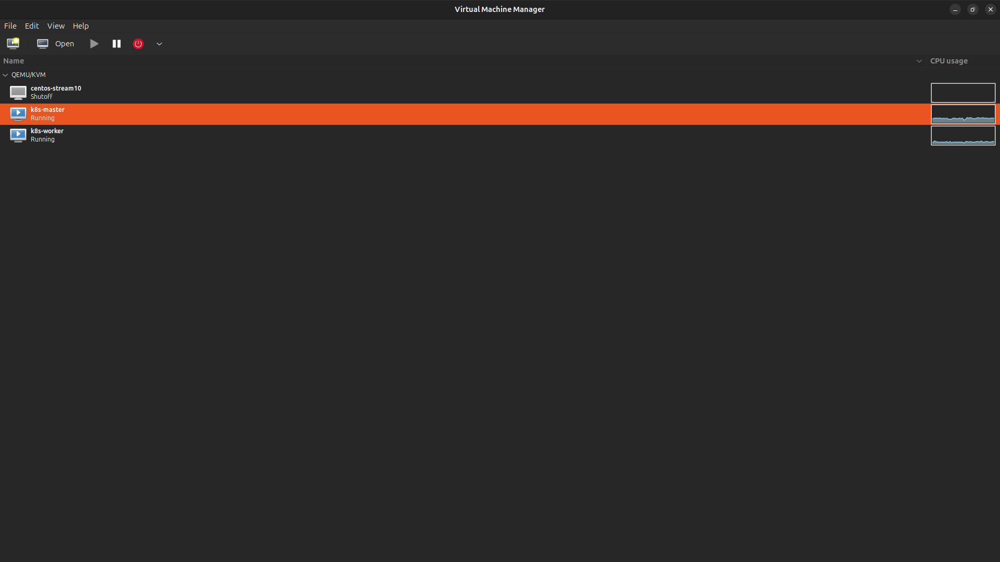
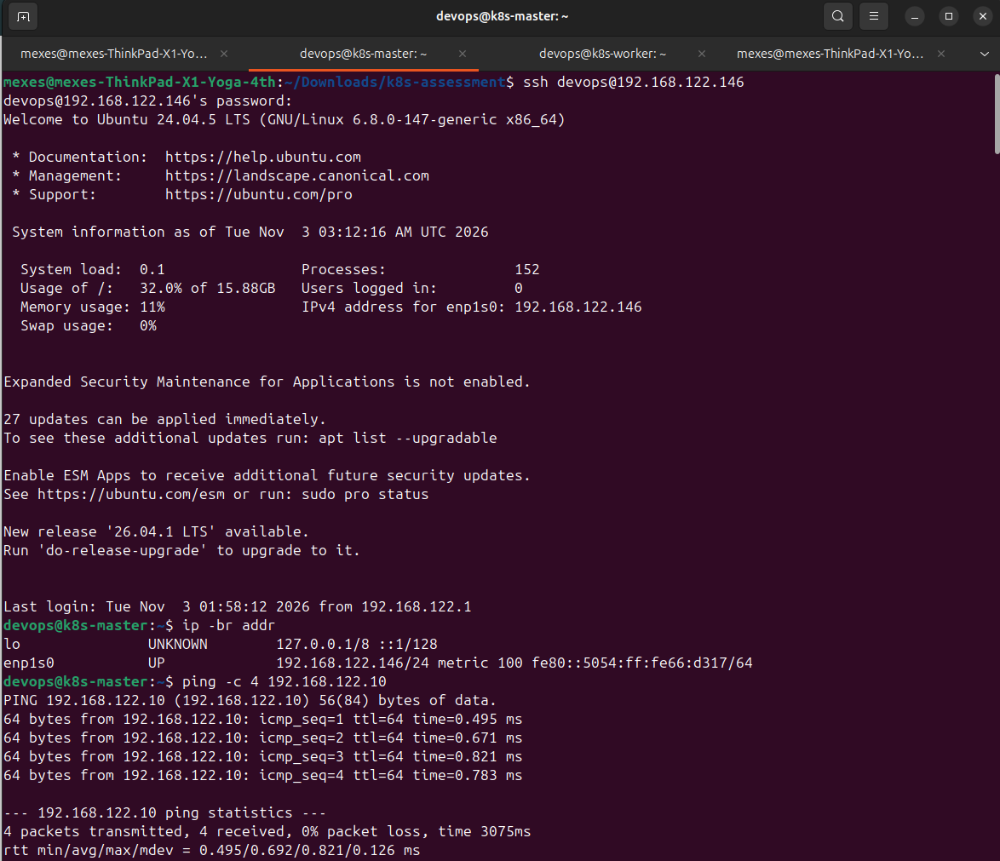
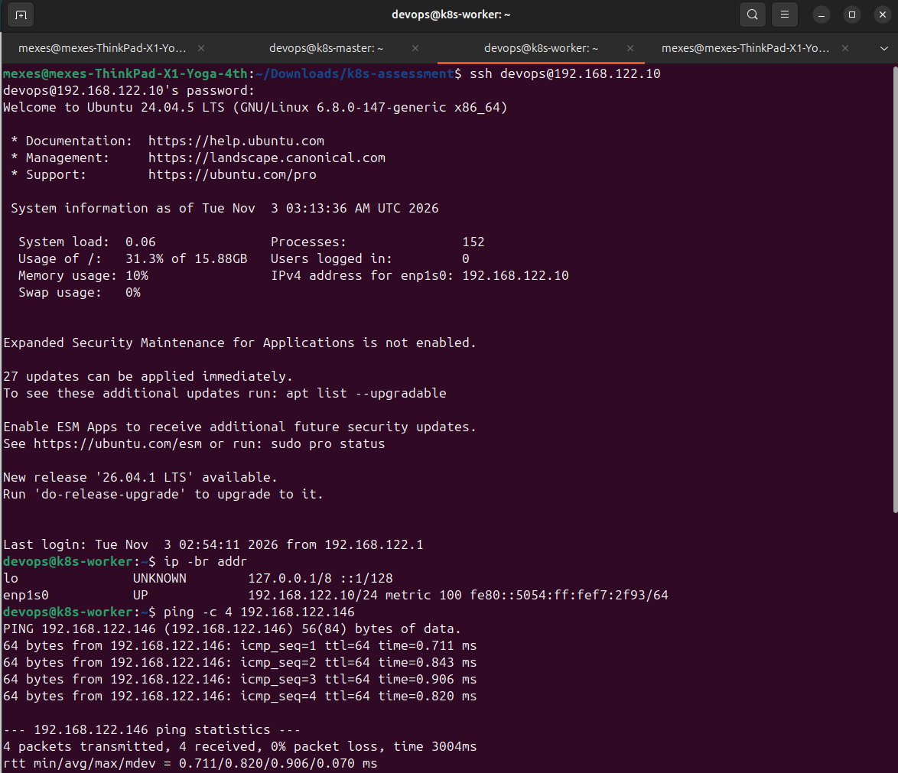
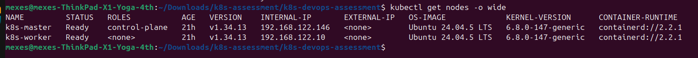
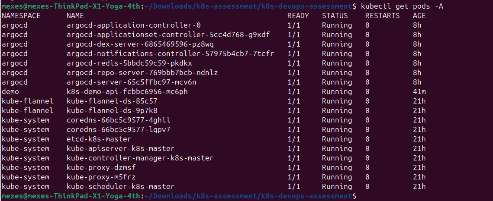
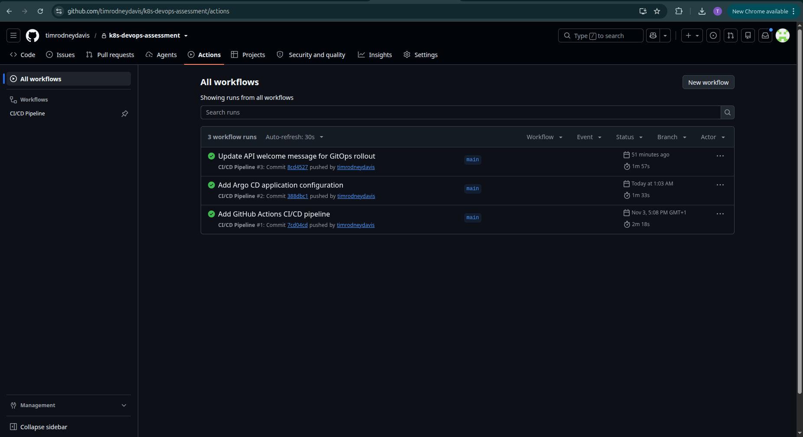
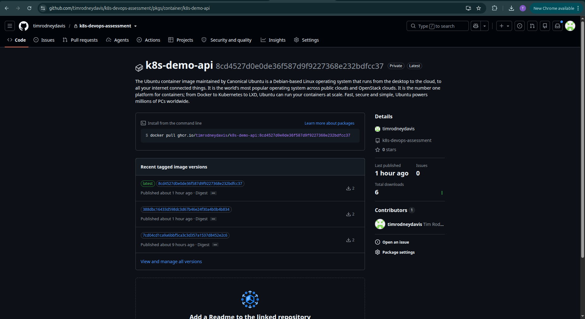
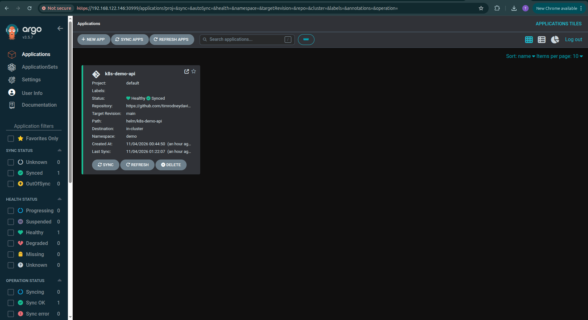
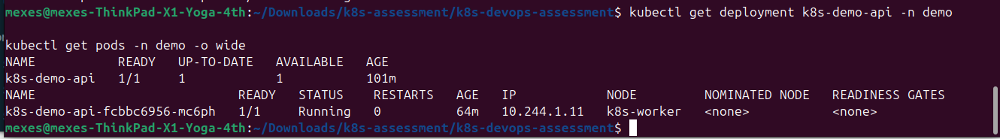
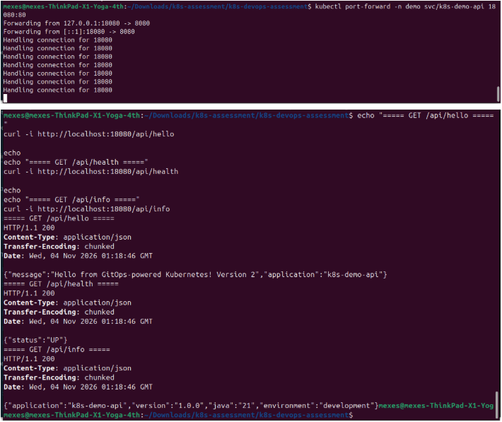

# Kubernetes & DevOps Assessment — Spring Boot API

## 1. Project Overview

This project demonstrates the deployment and continuous delivery of a Spring Boot REST API to a two-node Kubernetes cluster using Docker, Helm, GitHub Actions, GitHub Container Registry (GHCR), and Argo CD.

The implementation follows a GitOps approach: application changes are committed to GitHub, GitHub Actions tests and builds a new container image, and Argo CD automatically deploys the updated image to Kubernetes by monitoring the Helm configuration in the Git repository.

### Key Features

- Two-node Kubernetes cluster provisioned using kubeadm.
- Spring Boot REST API with three endpoints.
- Multi-stage Docker build using Java 21.
- Private Docker image storage in GHCR.
- Configurable Helm chart.
- Automated testing and image publishing with GitHub Actions.
- GitOps-based deployment and reconciliation with Argo CD.
- Kubernetes startup, readiness, and liveness probes.
- Kubernetes image pull secret for private registry authentication.

## 2. Architecture

```text
Developer
    |
    | Git push
    v
GitHub Repository
    |
    v
GitHub Actions
    |
    +---- Run Maven tests
    |
    +---- Build Docker image
    |
    +---- Push image to GHCR
    |
    +---- Update Helm values.yaml with image tag
    |
    v
GitHub Repository (updated Helm values)
    |
    v
Argo CD
    |
    | Detect Git changes
    v
Helm Chart
    |
    v
Kubernetes Cluster
    |
    +---- Control Plane
    |
    +---- Worker Node
              |
              v
         Spring Boot API
```

### Technology Stack

| Component | Technology |
|---|---|
| Application | Java 21, Spring Boot 3.5.7 |
| Build tool | Maven |
| Containerization | Docker |
| Container registry | GitHub Container Registry |
| Orchestration | Kubernetes 1.34 |
| Cluster provisioning | kubeadm |
| Container runtime | containerd |
| Networking | Flannel CNI |
| Package management | Helm |
| CI/CD | GitHub Actions |
| GitOps | Argo CD |
| Source control | Git and GitHub |

## 3. Repository Structure

```text
k8s-devops-assessment/
│
├── spring-boot-api/
│   ├── src/
│   │   ├── main/
│   │   │   ├── java/com/assessment/demo/
│   │   │   │   ├── DemoApiApplication.java
│   │   │   │   └── HelloController.java
│   │   │   └── resources/
│   │   │       └── application.properties
│   │   └── test/
│   │       └── java/com/assessment/demo/
│   │           └── HelloControllerTest.java
│   ├── Dockerfile
│   └── pom.xml
│
├── helm/
│   └── k8s-demo-api/
│       ├── Chart.yaml
│       ├── values.yaml
│       └── templates/
│           ├── _helpers.tpl
│           ├── deployment.yaml
│           ├── service.yaml
│           └── ingress.yaml
│
├── argocd/
│   └── application.yaml
│
├── .github/
│   └── workflows/
│       └── ci-cd.yaml
│
├── .gitignore
└── README.md
```

## 4. Spring Boot API

The application exposes three REST endpoints on port `8080`.

| Endpoint | Method | Description |
|---|---|---|
| `/api/hello` | GET | Returns a welcome message |
| `/api/health` | GET | Returns application health status |
| `/api/info` | GET | Returns application information |

### Example Responses

**GET /api/hello**

```json
{
  "message": "Hello from GitOps-powered Kubernetes! Version 2",
  "application": "k8s-demo-api"
}
```

**GET /api/health**

```json
{
  "status": "UP"
}
```

**GET /api/info**

```json
{
  "application": "k8s-demo-api",
  "version": "1.0.0",
  "environment": "development",
  "java": "21"
}
```

### Run Tests Locally

Requirements: Java 21 and Maven.

```bash
mvn -f spring-boot-api/pom.xml clean test
```

## 5. Docker Image

The application uses a multi-stage Dockerfile.

- Build stage: Maven with Eclipse Temurin 21.
- Runtime stage: Eclipse Temurin 21 JRE.
- Runs as a non-root user with UID `10001`.
- Exposes port `8080`.

### Build Locally

```bash
docker build \
  -t k8s-demo-api:local \
  ./spring-boot-api
```

### Run Locally

```bash
docker run -d \
  --name k8s-demo-api-test \
  -p 8080:8080 \
  k8s-demo-api:local
```

Test the application:

```bash
curl http://localhost:8080/api/hello
curl http://localhost:8080/api/health
curl http://localhost:8080/api/info
```

## 6. Kubernetes Cluster

The project uses a two-node Kubernetes cluster provisioned with kubeadm.

| Node | Role | Configuration |
|---|---|---|
| k8s-master | Control plane | 2 vCPU, 2 GB RAM |
| k8s-worker | Worker | 2 vCPU, 2 GB RAM |

Cluster networking is provided by Flannel using the pod CIDR:

```text
10.244.0.0/16
```

Container runtime: containerd.

Kubernetes components were installed using the official Kubernetes package repository.

### Verify Cluster

```bash
kubectl get nodes -o wide
kubectl get pods -A
```

Both nodes should report `Ready`.

## 7. Helm Chart

The Helm chart is located at:

```text
helm/k8s-demo-api/
```

It contains templates for:

- Deployment
- Service
- Ingress
- Shared naming and labeling helpers

### Configurable Values

The chart supports configurable:

- Container image repository and tag.
- Image pull policy.
- Replica count.
- Container and service ports.
- Resource requests and limits.
- Image pull secrets.
- Startup, readiness, and liveness probes.
- Ingress configuration.
- Node selectors, affinity, and tolerations.

### Validate the Chart

```bash
helm lint helm/k8s-demo-api
```

Render the Kubernetes manifests:

```bash
helm template k8s-demo-api helm/k8s-demo-api
```

Render with Ingress enabled:

```bash
helm template k8s-demo-api helm/k8s-demo-api \
  --set ingress.enabled=true
```

Ingress is disabled by default. An Ingress controller is required for actual Ingress routing.

## 8. GitHub Actions CI/CD Pipeline

Workflow location:

```text
.github/workflows/ci-cd.yaml
```

The pipeline is triggered by pushes to the `main` branch and pull requests targeting `main`. It also supports manual execution.

### Pipeline Stages

**Stage 1 — Test**

- Checks out the source code.
- Sets up Java 21.
- Runs Maven tests.
- Prevents the image build stage from proceeding if tests fail.

**Stage 2 — Build and Push**

- Authenticates to GHCR using GitHub's `GITHUB_TOKEN`.
- Builds the Docker image.
- Pushes a commit-SHA-tagged image and a `latest` image to GHCR.

**Stage 3 — GitOps Update**

- Updates the image tag in:

```text
helm/k8s-demo-api/values.yaml
```

- Commits and pushes the updated Helm configuration to GitHub.

The workflow ignores changes to `values.yaml` and `README.md` to prevent unnecessary workflow executions caused by its own GitOps update.

Pull requests run tests but do not publish images.

### Image Naming

```text
ghcr.io/timrodneydavis/k8s-demo-api:<commit-sha>
```

## 9. Private Registry Authentication

The Docker image is stored in a private GitHub Container Registry package.

Kubernetes uses an image pull secret named:

```text
ghcr-pull
```

The secret is created in the `demo` namespace and referenced by the Helm Deployment.

Example creation command:

```bash
read -rsp "Enter GHCR token: " GHCR_TOKEN
echo

kubectl create secret docker-registry ghcr-pull \
  --namespace demo \
  --docker-server=ghcr.io \
  --docker-username=YOUR_GITHUB_USERNAME \
  --docker-password="$GHCR_TOKEN" \
  --dry-run=client -o yaml | kubectl apply -f -

unset GHCR_TOKEN
```

The GitHub token used for image pulls requires the `read:packages` permission and access to the private package.

No registry credentials are committed to the Git repository.

## 10. Argo CD GitOps Deployment

Argo CD is installed in the `argocd` namespace.

The Argo CD Application manifest is located at:

```text
argocd/application.yaml
```

Application configuration:

| Setting | Value |
|---|---|
| Application | k8s-demo-api |
| Project | default |
| Source branch | main |
| Source path | helm/k8s-demo-api |
| Destination namespace | demo |
| Automated sync | Enabled |
| Prune | Enabled |
| Self-heal | Enabled |

The Application uses the private GitHub repository credentials stored as an Argo CD repository Secret.

### Apply the Application

```bash
kubectl apply -f argocd/application.yaml
```

### Verify Argo CD

```bash
kubectl get applications -n argocd
kubectl get pods -n argocd
```

### Argo CD Web Interface

The Argo CD server is exposed using NodePort `30999`.

```text
https://<MASTER-IP>:30999
```

The initial administrator username is `admin`.

## 11. Deployment Verification

### Check Kubernetes Nodes

```bash
kubectl get nodes -o wide
```

### Check Application Deployment

```bash
kubectl get deployment k8s-demo-api -n demo
kubectl get pods -n demo
kubectl get services -n demo
```

### Check Deployment Rollout

```bash
kubectl rollout status deployment/k8s-demo-api -n demo
```

### Check Argo CD Application Health

```bash
kubectl get applications -n argocd
```

Expected application state:

```text
NAME           SYNC STATUS   HEALTH STATUS
k8s-demo-api   Synced        Healthy
```

### Test the Kubernetes Service

Forward the service port:

```bash
kubectl port-forward -n demo svc/k8s-demo-api 18080:80
```

In another terminal:

```bash
curl http://localhost:18080/api/hello
curl http://localhost:18080/api/health
curl http://localhost:18080/api/info
```

## 12. End-to-End GitOps Demonstration

The deployment was tested by changing the API welcome message from:

```text
Hello from Kubernetes DevOps Assessment!
```

to:

```text
Hello from GitOps-powered Kubernetes! Version 2
```

The corresponding automated test was updated and the Maven test suite passed.

The code change was committed and pushed to GitHub.

The following sequence then occurred automatically:

1. GitHub Actions detected the code change.
2. Maven tests ran successfully.
3. Docker built the updated application image.
4. The image was pushed to GHCR using the commit SHA as its tag.
5. GitHub Actions updated the Helm image tag in the repository.
6. Argo CD detected the updated Git configuration.
7. Argo CD synchronized the Helm chart.
8. Kubernetes pulled the new private image and performed a rolling update.
9. The new pod became ready and the old pod was terminated.
10. The API returned the updated welcome message.

### Verified Final API Response

```json
{
  "message": "Hello from GitOps-powered Kubernetes! Version 2",
  "application": "k8s-demo-api"
}
```

The final deployment was verified with:

- Argo CD application: `Synced` and `Healthy`.
- Kubernetes Deployment: `1/1` available.
- New application pod: `1/1 Running`.
- All three REST endpoints responding successfully.

## 13. Security Considerations

- The application container runs as a non-root user.
- Kubernetes image registry credentials are stored in a Kubernetes Secret.
- GitHub Actions uses the built-in `GITHUB_TOKEN` for publishing images and updating the repository.
- Argo CD uses separate repository credentials for private Git access.
- Credentials and environment files are excluded from Git using `.gitignore`.
- No cluster-admin kubeconfig is stored in GitHub Actions secrets.
- Private container images are pulled using the dedicated `ghcr-pull` secret.

## 14. Troubleshooting

**ImagePullBackOff**

Check pod events:

```bash
kubectl describe pod <POD-NAME> -n demo
```

Verify the image pull secret:

```bash
kubectl get secret ghcr-pull -n demo
```

Ensure the GHCR token has `read:packages` permission and access to the private image.

**Argo CD OutOfSync or Progressing**

```bash
kubectl get applications -n argocd
kubectl describe application k8s-demo-api -n argocd
```

**Application pod not ready**

```bash
kubectl describe pods -n demo
kubectl logs -n demo deployment/k8s-demo-api
```

**Port-forward connection issues**

Restart the port-forward:

```bash
kubectl port-forward -n demo svc/k8s-demo-api 18080:80
```

## 15. Conclusion

This project demonstrates an automated Kubernetes deployment workflow using CI/CD and GitOps principles.

It integrates application testing, containerization, private image publishing, Helm-based configuration, and Argo CD continuous reconciliation.

The end-to-end rollout demonstrates that a source-code change can be tested, packaged, published, and deployed to Kubernetes through Git-based automation without manually deploying the application from the CI pipeline.

## 16. Implementation Evidence

The following screenshots document the infrastructure setup, Kubernetes cluster, CI/CD pipeline, GitOps deployment, and API verification.

### 16.1 Virtual Machine Infrastructure

**Running virtual machines**



**Kubernetes control-plane VM**



**Kubernetes worker VM**



### 16.2 Kubernetes Cluster

**Kubernetes nodes**



**Kubernetes system pods**



### 16.3 CI/CD and Container Registry

**GitHub Actions workflow**



**GitHub Container Registry package**



### 16.4 GitOps Deployment

**Argo CD dashboard**



**Application deployment**



### 16.5 API Verification

**API endpoint responses**


